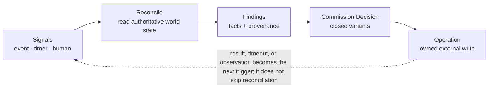
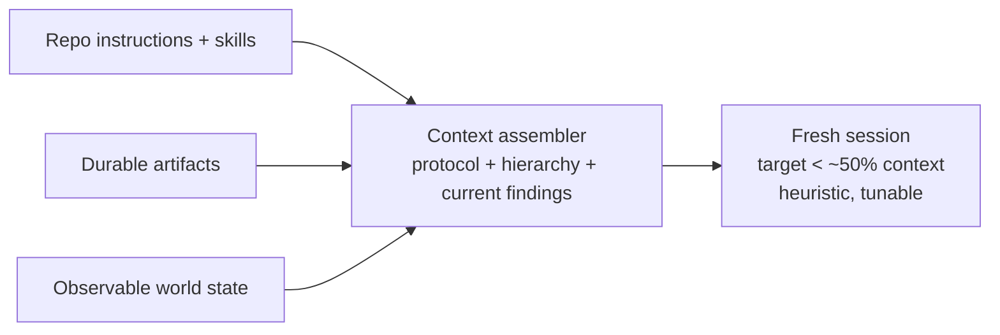
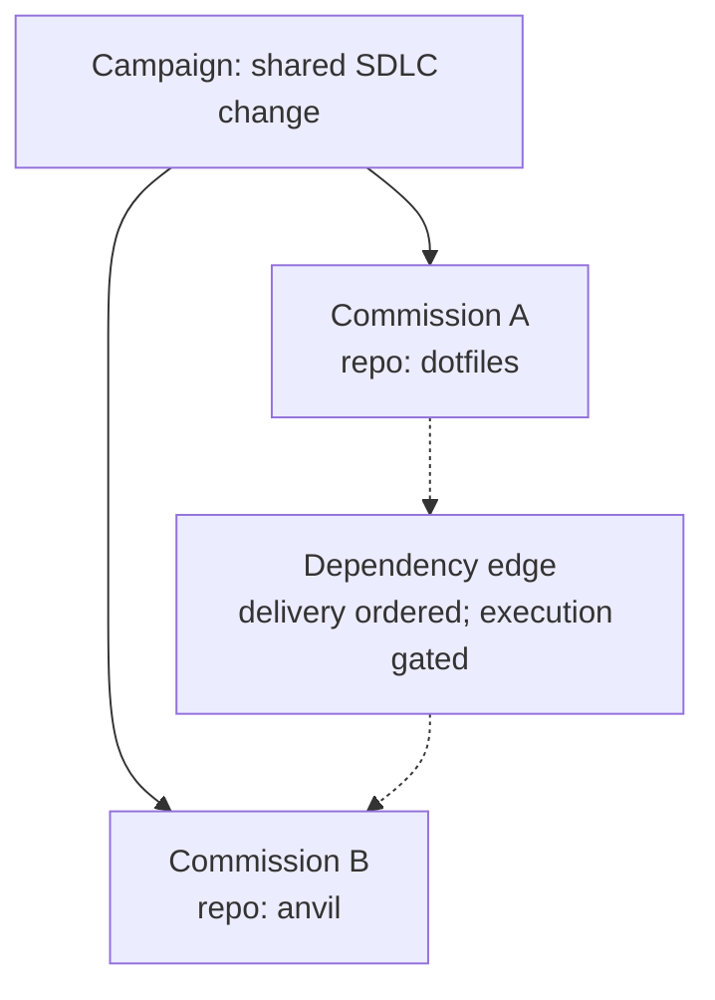

# Anvil — Architecture specification

**Architecture specification · draft**

Anvil implements the outer control loop around OpenCode execution. It observes durable intent and external system state, authorizes bounded continuation or recovery, and records the basis for each consequential operation.

**Status:** Observed state and provenance · Selective model assessment · Operation recovery unresolved

## Domain engine and effect boundary

A single pure, cohesive functional core SHALL own Commission identity, lifecycle,
decision authorization, state evolution, evidence policy and Operation transition
constraints. It receives explicit immutable inputs and returns exhaustive typed
results, without I/O, hidden time/randomness, mutation or provider calls. SQLite,
HTTP, MCP and UI SHALL NOT redefine domain policy. Repeated identical Wait, Hold
or Escalate decisions are no-ops: no new Operation, unnecessary state version or
SQL write.

One authoritative SQL Operation journal SHALL persist the approved transition and
prepared Operation atomically before external mutation. Operation identity,
target/preconditions and original owner remain stable across restart. A legitimate
successor may inspect and record a predecessor's dispatched outcome without
impersonation or replay; stale holders cannot authorize new writes. Provider-proven
safe retry retains the original logical identity and bounded count, and
`retry_authorized` remains unresolved until resolved. Ordered transactional
migrations and SQLite reopen preserve state.

Adapters SHALL preserve provider-owned IDs and distinguish failure from unknown
or unavailable. Protocol-compatible local tests validate production-intended
adapters without substituting fakes for real integrations. Local test results and
live provider validation remain distinct.

## Outer reconciler

Events, timers, and authorized interventions trigger reconciliation. Anvil reads its current specification and the relevant external authorities, derives typed observations and Findings, evaluates Commission policy, records any authorized Operation, and later observes its postcondition. Webhook delivery or OpenCode session idleness alone does not establish completion.



## In-flight execution assessment

The watchdog observes OpenCode activity while the current turn is active. It may propose an intervention without waiting for the session to become idle. A Commission controller remains the only authority that may authorize execution changes.

| Observation | Assessment | Permitted initial response |
| --- | --- | --- |
| Repeated normalized tool errors or identical failing command output | Suspected operational loop; not proof of stalled engineering progress | Record failure pattern; request a checkpoint or scoped steering if policy permits |
| Context occupancy approaches a configured limit | Context pressure | Prepare fresh-session handoff at a safe operation boundary |
| Same failing check across materially different revisions | Possible unsuccessful repair strategy | Preserve diagnostics; select bounded repair, new strategy, or escalation |
| No observable activity within a declared budget interval | Possible stall or unavailable external dependency | Inspect running operation and environment before interrupting |
| Hard cost, time, or authority limit | Execution cannot continue under current authorization | Hold or terminate execution safely; record required intervention |

Interventions must distinguish monitoring, requesting a checkpoint, interactive steering, refreshing context, changing Attempt strategy, and holding work. Automatic interruption of an active tool requires an explicit safety policy; elapsed time or repeated failure alone is not sufficient proof that interruption is safe.

## Context refresh

The repository's `AGENTS.md` and skills define project conventions and development commands. Anvil supplies its own operational/reporting protocol, approved Campaign and Commission objectives, Assignment/Attempt identity, previous strategy outcomes, and current Findings. The context builder reads durable records and external observations; it does not duplicate the repository instructions or replay the prior transcript.



Existing session continuation can receive a smaller delta. Structured agent reports and todos are useful, non-authoritative signals.

## Controller decisions

| Variant | Precondition | Recorded outcome |
| --- | --- | --- |
| `Wait` | Execution or integration is progressing, or no authorized action is currently useful | Wait condition, external source, next observation deadline |
| `Continue` | Incomplete work has a justified next instruction and remaining budget | Assignment, instruction generation, current context boundary |
| `Repair` | Known diagnostic is actionable by the implementer | Finding IDs, applicable Candidate and bounded repair objective |
| `RefreshContext` | Context pressure or a deliberate session boundary warrants reconstruction | Checkpoint, provenance of reconstructed context, resumed Attempt |
| `ChangeStrategy` | Prior approach met a policy-defined failure or non-productivity criterion | Attempt disposition, preserved workspace state, new bounded strategy |
| `Verify` | Stable Candidate is available and configured checks are not current | Candidate identity, check profile, environment, evaluation operation |
| `Integrate` | Required gates for an identified Candidate are satisfied | Authorization, branch/PR operation, integration preconditions |
| `Hold` | Budget, dependency, authority, or infrastructure blocks further execution | Reason and conditions that permit resumption |
| `Escalate` | Available evidence cannot justify a safe next action within policy | Question, supporting evidence, proposed options and required authority |
| `Conclude` | Authoritative delivery evidence and configured Commission conditions are satisfied | Outcome, delivered revision and applicable verification results |

**Provisional policy.** Context utilization near 50% is a tunable refresh heuristic, not an empirical guarantee. Non-productivity detection, failure normalization, fresh-Attempt budgets, and safe interruption remain specified as policy extension points rather than invented numerical thresholds.

## Claims, observations, and acceptance evidence

**Agent-reported state — planning and continuation input.** OpenCode todos, explicit `anvil_report` dispositions, and agent summaries describe the implementer's view of completed and remaining work. They can direct inspection and prompt construction but cannot independently establish correctness.

**Externally observed state — policy and delivery input.** Git revision, test results, CI check identity, GitHub PR state, and merge outcome are recorded with timestamps, source authority, and Candidate applicability. Passing checks establish only the properties those checks actually measure.

```typescript
AcceptanceResult =
  | { kind: 'satisfied'; candidate: CandidateId; evidence: EvidenceRef[] }
  | { kind: 'failed'; candidate: CandidateId; findings: FindingId[] }
  | { kind: 'pending'; candidate: CandidateId; checks: CheckRef[] }
  | { kind: 'unavailable'; reason: ObservationFailure }
  | { kind: 'not_configured'; assurance: AssuranceKind };
```

An implementer must not be able to change a protected acceptance policy merely by editing tests in its workspace. Independent verification is optional by Commission policy; absence of independent assessment must remain distinguishable from an independently verified outcome.

## Convergence and review projections

**Provisional direction · #8.** Commission reconciliation computes an evidence and review-readiness projection from authoritative specification generations, worker reports, observable Git/CI results, durable Findings, and review decisions. Review is an explicit waiting condition for a policy requiring operator authorization. Neither Lific plan completion nor model self-report establishes delivery.

The illustrative progress card, review/inbox mockups, and convergence flow remain in [the HTML review mockups](review-mockups.html#convergence-review-ux).

The UI SHALL distinguish observed facts, worker-reported progress, controller assessments, stale information, and authorized interventions. Inbox rows are derived from Commission state; they are not separate persisted lifecycle aggregates. Completion requires authoritative integration outcome, not mere approval, CI success, or PR creation.

See [Acceptance obligations and review contract](spec.md#acceptance-obligations-evidence-and-review) for the normative boundaries.

## Interactive steering and acceptance generation

Steering instructions within approved scope reuse the existing Assignment and Workspace. Findings or newly requested semantic gates do not override previous acceptance criteria: when a request changes success requirements, Anvil requires an attributable typed amendment with an expected specification generation. Evidence remains revision- and criterion-scoped, and unchanged evidence can be retained when still applicable. A review-readiness or integration approval decision invalidated by a new Candidate or substantive amendment SHALL be visibly reassessed before delivery authorization. While a human or ChatGPT actively steers the worker, autonomous controller prompts are deferred; the controller continues observing current state.

## Campaign graph across repositories



A Campaign orders independent Commissions by execution prerequisites and delivery dependencies. An upstream Candidate revision or published artifact may be a dependency condition; a later upstream change can invalidate downstream evaluation. Whether dependent changes use independent PRs or stacked integration remains OD-03/OD-04.

## Git publication and identity

**Provisional.**

Anvil registers the intended repository, nominal branch, integration target and pull request, then allows the implementation worker to perform ordinary local and remote Git operations using worker-scoped credentials. Reconciliation reads remote branch heads, pull request state, reviews, checks, and integration outcomes. Each immutable Candidate is identified by repository and Git commit OID. A pushed commit is not necessarily an accepted Candidate: the Commission control policy selects stable revisions for verification. Verification evidence records the actual tested revision and applicable integration context. Unexpected branch rewriting, pull request replacement, retargeting, or force-push is observed and reconciled; it does not silently amend Commission intent.

Git publication mediation, a shadow origin, or a Git proxy is NOT part of the initial required deployment. Such mediation remains a conditional option if measured failures or unacceptable credential boundaries justify it. No dedicated publication controller or general Git-transport service is required.

## Cross-Commission dependency coordination

**Provisional design and open research.**

A hard dependency defaults to sequential execution through the required delivered outcome. Contract-first decomposition MAY establish an independently approved, durable interface artifact or integrable contract Commission that permits downstream work against a pinned input. Parallel execution SHALL NOT be inferred solely from the existence of a dependency edge. Execution readiness and delivery readiness are distinct; final acceptance SHALL apply to the actual integrated upstream revision or artifact.

Cross-Commission communication is an open design problem, not a selected messaging service. Candidate mechanisms include durable asynchronous clarification requests, directed mailboxes, a shared issue/message board, typed Findings, and handoff/baton context for downstream Assignments. Messages MUST NOT silently amend acceptance criteria or requirements. The choice of transport, delivery checkpoint, acknowledgement semantics, interruption policy, recipient targeting, and correlation with revisions requires evidence and runtime feasibility testing. Do not assume mandatory messaging or filesystem leases.

## Dependency coordination and context handoff

**Provisional direction adopted · #5.**

For each dependency A -> B, Anvil evaluates whether B may begin implementation independently of whether B may integrate. The default execution gate is `AfterDelivery`; `AfterCheckpoint` enables pinned-input speculation; `Unrestricted` enables implementation concurrency for dependencies that constrain integration order only. All three preserve required upstream delivery ordering. Checkpoint identity and the delivered result may differ, and applicable downstream verification must account for that difference.

On a relevant dependency transition, Anvil constructs B's context from the approved objective, pinned upstream artifacts and revisions, authoritative delivery and CI evidence, applicable Findings, known limitations, and a concrete next directive. An upstream agent MAY provide supplementary handoff notes, but its self-reports SHALL NOT be promoted into authoritative acceptance evidence. The full upstream agent trajectory SHALL NOT be copied into B's new Session by default.

Anvil SHALL support durable asynchronous Commission-addressed coordination as a control-plane capability, without requiring a separate message broker for the baseline design. A worker MAY submit a scoped question, answer, operational Finding, or referenced artifact for another Commission or Campaign. Messages SHALL survive Session replacement and be delivered through the selected OpenCode prompt/inbox/context interfaces at suitable execution boundaries; ordinary upstream pushes SHALL NOT automatically cause prompt interruption. Message identity, provenance, recipient/audience, related contract/revision, and delivery disposition SHALL be observable. A message SHALL NOT independently amend requirements, acceptance, or integration authority.

File reservations and continuously broadcast group chat are not baseline requirements. Explicit contract artifacts and deterministic handoff context are preferred to mandatory peer-to-peer negotiation. Adapter-specific inbox hooks and message-delivery timing are implementation details; OpenCode documented capabilities may be used directly without pre-implementation experiments.

Dependency graph changes are governed amendments. A Commission controller MAY execute approved internal decomposition and retries without changing the Campaign graph. The Campaign's completion projection derives from all required delivered Commissions plus explicit Campaign-wide acceptance conditions, with blocked or unknown upstream states represented rather than inferred as success.

## Observation and mutation contracts

### Observed sources

- Anvil specification generation, permitted budget and previous Decisions
- OpenCode session/turn states, tool outcomes, todos and self-reports
- Workspace health, Git revision and uncommitted changes
- Repository-declared local checks and external CI checks
- GitHub PR, Mergify queue, merge and published artifact state

### Mutating operations

- Require current Commission authority, target ownership and stable operation identity
- Persist intent before issuing consequential external writes
- Record dispatched, acknowledged, failed, or ambiguous outcomes distinctly
- On ambiguous acknowledgement, inspect the remote system before retrying
- Re-observe external postconditions before advancing lifecycle state

Controller ownership uses per-Commission Kubernetes Leases. External mutation deduplication and ambiguous-result recovery require operation identities and provider-specific evidence; implementation validation remains OD-02.

## Commission ownership and operation recovery

Kubernetes `coordination.k8s.io/v1` Leases coordinate which controller instance can authorize mutations for a Commission. Lease renewal and acquisition use Kubernetes optimistic concurrency. Losing the Lease stops new command authorization, but cannot cancel operations already accepted by another service.

### Persist

- Approved Commission objective, current specification generation, dependencies, budgets, and acceptance rules
- Assignment/Attempt IDs, external resource references, and workspace/checkpoint IDs
- Authorized Operation ID, target, preconditions, dispatch status, and unresolved outcome

### Reconstruct

- OpenCode session, message, tool, and todo state
- Kubernetes sandbox lifecycle and associated resources
- Git revisions, branches, CI runs, GitHub PRs, and Mergify queue/merge state
- Current Commission assessment and next Decision from those observations

```text
onReconcile(commission):
  lease = acquireOrConfirmCommissionLease(commission)
  if lease is unavailable: observeOnly()
  else:
    state = loadDurableIntentAndUnresolvedOperations(commission)
    actual = observeExternalAuthorities(state.references)
    outcomes = resolveOperations(state.operations, actual)
    next = decide(state.intent, actual, outcomes)
    authorizeAndPersist(next, lease, state.generation)
    dispatchOnlyWhenSafe(next)
```

Caller-supplied remote idempotency identities are preferred when supported. Otherwise an Operation is reconciled against a provider's observable postcondition; ambiguous outcomes are not blindly replayed. A Kubernetes Lease does not fence an already-running external mutation, and `resourceVersion` is not a universal fencing token. Each adapter must document its own safe-retry conditions.

Every state query exposes the owner when known, most recent authoritative observation, outstanding Operations, and whether the next action is waiting for external state or intervention. Provider retention limitations are considered when selecting which evidence to retain durably.

## Kubernetes deployment inventory and preview routing

**Proposed inventory, not as-deployed verification.**

The operational inventory SHALL distinguish logical responsibilities from independently deployed Kubernetes resources. Expected logical components include anvild (HTTP/MCP API, Commission reconciliation, Operations and adapter orchestration), web interface, durable state store, existing Git credential broker, secrets, agent-sandbox runtime and isolated OpenCode sandboxes, versioned sandbox images, recoverable Workspace volumes, shared Nix daemon/cache, ingress and authentication, observability, and verification execution. GitHub, Mergify, Lific, and model providers are external dependencies. The actual Deployment/StatefulSet/Service/PVC/Secret topology SHALL be verified against the installed environment before documenting it as implemented.

Anvil SHALL provide authenticated HTTPS preview URLs for HTTP/WebSocket services running within a sandbox. A preview route SHALL be associated with sandbox identity and service port, resolve the current sandbox endpoint, enforce access control and network isolation, and cease routing to deleted or unauthorized sandboxes. Routing SHALL recover after component restart without treating a reachable URL as evidence that the preview service is healthy. Reuse existing Traefik ingress where possible; whether dynamic routing is handled within anvild or a distinct preview gateway remains open.

## Shared Nix execution and interactive steering

**Established topology, operational contract under refinement.** Anvil's existing sandbox infrastructure uses multi-user Nix with one shared Nix store. A dedicated Nix daemon Pod has exclusive read/write ownership of the store and its database. Worker sandboxes mount the shared store read-only and submit build/store operations through the daemon. Already-realized derivations become immediately reusable across sandboxes without per-session store warmup. This topology is an explicit baseline requirement for v2; it is not a deferred optional caching optimization.

The deployment architecture SHALL account for the Nix daemon, its dedicated persistent store, the read-only sandbox mounts, daemon transport/access control, build-user isolation, workspace mounts, and sandbox image/runtime compatibility. Worker access to the daemon SHALL NOT imply trusted-user privileges. The build service SHALL preserve sandboxing and bounded resource consumption; untrusted builds, shared build saturation, node/storage placement, Nix garbage-collection roots and disk capacity are operational concerns. Existing configuration is the implementation starting point, not a reason to build a second Nix provisioning system.

Anvil SHALL support interactive steering of an existing Assignment/Workspace without requiring a new Commission, Attempt, or sandbox for every operator or ChatGPT instruction. A user MAY open a sandbox service through its authenticated preview URL, inspect running changes, request incremental edits through ChatGPT/HTTP/MCP, and continue using the same working context. Such steering SHALL be serialized with ongoing OpenCode command admission, preserve Commission authority, and be observable through the same Commission state and evidence projections. Anvil's autonomous controller SHALL NOT compete with interactive steering by injecting conflicting instructions. The mechanism for temporarily deferring autonomous continuations, resuming supervision, and expiring abandoned interactive control is an implementation policy to be finalized alongside lifecycle semantics.

Preview routing SHALL support stable service identity and HTTP/WebSocket traffic while the underlying sandbox is available. Preview availability is operational access, not proof that acceptance obligations are satisfied. The interactive path SHALL retain fast local Nix development-shell checks; it SHALL NOT require a full SDLC Nix-build CI run after each incremental edit.

## Sandbox runtime convergence

Anvil owns the desired runtime specification for an Assignment, including the approved Sandbox image revision, OpenCode runtime/plugin/config revision, runtime resources, Workspace identity, credential profile, and service routing requirements. Kubernetes and agent-sandbox own the actual Pod/Service lifecycle. The Anvil controller compares desired and observed versions and health, then chooses maintain, live reload, defer, replace, or escalate. The precise Pod replacement and upgrade operation is an adapter-level concern; Anvil SHALL use native agent-sandbox reconciliation where available and SHALL NOT build a competing Kubernetes Pod controller.

Use an immutable runtime image digest or equivalent resolved version as the comparison identity; mutable floating tags SHALL NOT silently upgrade active Assignments. A routine image update waits for a checkpoint when OpenCode work and interactive steering can safely pause. If replacement is required, Anvil SHALL verify that Workspace persistence, uncommitted changes, OpenCode Session data where available, and necessary identity references are recoverable before retiring the old Sandbox. Workspace volume access and Nix store placement may require a sequential rather than overlapping Pod swap; do not assume dual mounting or simultaneous writers is safe.

After replacement, reconcile OpenCode connection and Session binding, preview/service endpoint, Git branch and Candidate observations, Nix daemon connectivity, and outstanding Operations before admitting further prompts. A Session that must be reconstructed does not imply a fresh Attempt or loss of approved Commission acceptance obligations. Failures, upgrade deferrals, and unavoidable continuity loss SHALL be explicit observable conditions rather than silent recreation loops. Rollout cadence, compatibility testing, emergency patch policy, and retention are implementation policies.

## Implementation stack: TypeScript end-to-end

**Accepted language and frontend direction · ADR-001.** Anvil SHALL implement the daemon, HTTP/MCP application surface, domain/reconciliation logic, web UI and OpenCode plugin in TypeScript. Rust MAY be reconsidered for stabilized daemon internals only when operational evidence justifies the cost; the initial design SHALL optimize for a fast unified development loop. See [ADR-001](adr-001-typescript-stack.md).

The initial daemon runtime is pinned Bun, with a prompt switch to Node.js upon material runtime friction. Bun standalone compilation is a packaging target: the executable embeds the Bun runtime, allowing a minimal OCI image without a separate Bun executable. Compilation SHALL NOT block early vertical slices. Runtime-specific integrations SHALL be isolated to preserve the fallback.

The authenticated operations UI SHALL use React, Vite, TanStack Router and Query, Tailwind CSS, and shadcn/ui. Ledger visual tokens remain the default. Anvil already has an authoritative API/controller, so Next.js server-rendering and Server Actions are not required for v2. HTTP routing SHOULD use a thin Hono adapter. Shared runtime-validated contracts, strict discriminated unions, exhaustive reconciliation logic and existing SQLite migration/recovery contracts are retained.

The daemon, UI and Sandbox runtime SHALL be packaged declaratively through Nix,
using nix2container with explicit sensible layering where useful. Runtime contents,
startup, migration, configuration/credential assumptions, probes and ports require
local validation. Deployment interfaces identify immutable images/digests,
namespaces, Secret references, health/readiness and compatible agent-sandbox/shared
Nix contracts; deployment authority remains separate from artifact readiness.

## Observability and intervention API

HTTP and MCP expose the same domain-level read and mutation capabilities. A caller may obtain a Campaign aggregate without enumerating transcripts. Responses distinguish observed facts, agent self-reports, controller assessments, evidence freshness, and intended next actions.

| Capability | Contract |
| --- | --- |
| `get_campaign` | Commission graph, dependencies, per-Commission dispositions, blockers and delivery status |
| `get_commission` | Specification generation, Assignment/Attempt, Candidate, checks, external integration, last Decision, next intended action and observation time |
| `get_assignment` / `get_history` | Session identity, agent plan, recent tool failures, checkpoints, Findings and bounded decisions without requiring full transcript replay |
| `steer_assignment` | Interactive instruction to the currently authorized Session; controller correction prompts do not race the interactive writer |
| `amend_commission` | Governed persistent specification or strategy change, incrementing generation and invalidating affected acceptance results |
| `hold_commission` / `resume_commission` | Explicit operator control of autonomous execution with recorded authority and preconditions |

A status such as “required CI checks pass; awaiting Mergify” is a projection of observed check and integration state, not a generated claim of delivery. The API must also expose when that observation is stale or unavailable.
