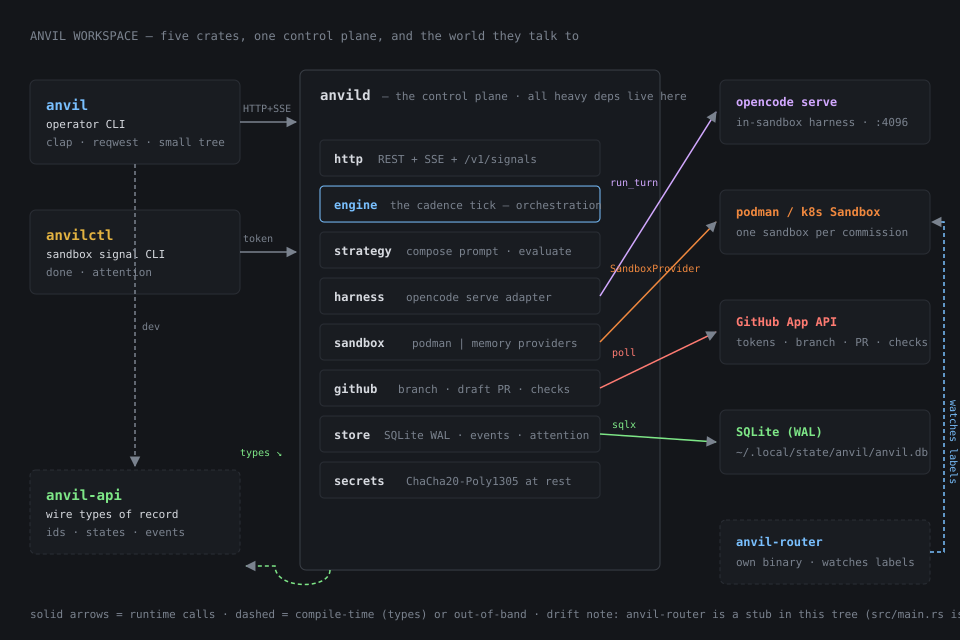
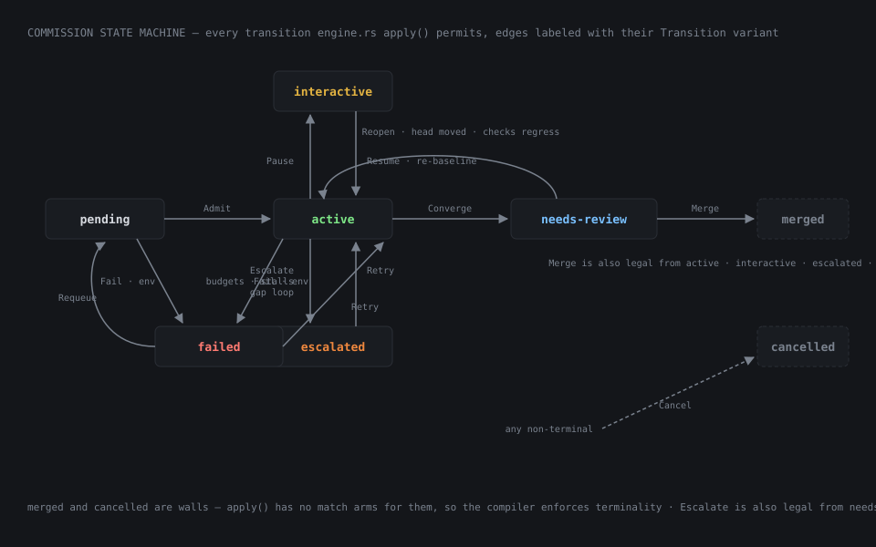

# Anvil — Codebase Walkthrough

A guided tour of the implementation as it exists in this tree: the layout, the
packages, the loop, and the seams. This page is **non-normative** — the product
contract lives in [spec.md](spec.md) §3 and the structural rules in
[architecture.md](architecture.md); where those pages and this one disagree,
they win and this page is stale. Every claim below is anchored to a file you can
open. Serve it with live reload while you poke at the code:

```sh
just docs        # nix run .#docs -- --root docs --project .
```

<style>
.w-box { background:#14161a; border:1px solid #2a2e35; border-radius:6px;
         padding:1rem 1.25rem; margin:1.25rem 0; color:#d7dae0;
         font-size:.82rem; overflow-x:auto; }
.w-box .t { color:#7a828e; font-size:.72rem; letter-spacing:.08em;
            margin-bottom:.6rem; }
.w-chips { margin:.75rem 0; }
.w-chip { display:inline-block; margin:.15rem .3rem .15rem 0; padding:.1rem .5rem;
          border:1px solid #3a3f47; border-radius:3px; color:#d7dae0;
          font-size:.78rem; white-space:nowrap; }
.w-chip b { color:#7ee787; font-weight:600; }
.w-note { border-left:3px solid #e3b341; background:#191c21; padding:.6rem 1rem;
          margin:1rem 0; font-size:.88rem; }
</style>

## 1. The mental model

Anvil drives coding agents to **merged pull requests without a human in the
loop**. Operators submit a *campaign*; the control plane decomposes it into
*commissions* (one repo, one branch, one PR each), spawns an opencode v2 agent
inside a quarantined *sandbox* per commission, and re-prompts it turn after turn
until the PR's checks go green — or a budget runs out and a human is asked to
look. Human attention is the scarce resource; the *inbox* is its budget, and
inbox items arise only from deterministic control-loop transitions.

The vocabulary you need to read any file (full table in [spec.md](spec.md) §2):

<div class="w-chips">
<span class="w-chip"><b>campaign</b> — a unit of operator intent; ordered commissions + shared context</span>
<span class="w-chip"><b>commission</b> — one repo, one target ref, one branch, one PR</span>
<span class="w-chip"><b>obligation</b> — freeform durable requirement (o1..on)</span>
<span class="w-chip"><b>attempt</b> — one convergence episode of turns</span>
<span class="w-chip"><b>turn</b> — one agent invocation (prompt → result)</span>
<span class="w-chip"><b>attention item</b> — deterministic state transition surfaced to the operator</span>
<span class="w-chip"><b>strategy</b> — turn composition + evaluation policy, selected by config</span>
<span class="w-chip"><b>sandbox</b> — quarantined workspace (podman locally, k8s in production)</span>
<span class="w-chip"><b>inner harness</b> — opencode v2 running inside the sandbox</span>
<span class="w-chip"><b>wave</b> — dependency epoch; wave N+1 admits when wave N is terminal</span>
</div>

Three invariants hold the design together, and the code is organized to make
them cheap to verify:

1. **State is derived from observables, never resident.** The engine is a
   stateless cadence tick that reads two observables — the SQLite store (the
   canonical internal record) and live GitHub state (PR checks, mergeability,
   target-head movement, fetched fresh through `external_state`,
   `crates/anvild/src/engine.rs:616`) — decides, and writes back. A restarted
   daemon resumes with zero ceremony (`crates/anvild/src/main.rs:56` closes
   turns left in flight by the previous boot, and off it goes).
2. **Anvil never commits.** It provisions the branch and draft PR at admission;
   the agent owns every commit and push; PR checks are the convergence gate.
3. **Agents only run inside sandboxes.** The host executes no agent code;
   opencode runs with full auto-approve behind a container boundary.

## 2. The repository map

One Cargo workspace, one nix flake, one docs tree:

```sh
anvil-next/
├── AGENTS.md               # the map for agents (you are expected to obey it)
├── justfile                # docs · ci-check · ci-verify · keygen · auth-onboard · daemon …
├── Cargo.toml              # workspace: 5 members, shared dep versions
├── ci.nix                  # blogle/sdlc contract: check (admission) + verify (merge-candidate)
├── flake.nix               # crane-built packages, the sandbox image, the docs app
├── .changes/               # changelog stubs — never edit CHANGELOG.md directly
├── crates/
│   ├── anvil-api/          # wire types: ids, states, events, payloads
│   ├── anvil/              # operator CLI
│   ├── anvild/             # the control plane (daemon)
│   ├── anvilctl/            # sandbox signal CLI (done / attention)
│   └── anvil-router/       # preview proxy (stub — see §9)
├── docs/                   # this tree: spec, architecture, research, mockups
└── skills/                 # software-craft (implementation rules) · walkthrough-author (doc upkeep)
```

Release hygiene is mechanical: `just changelog-check` validates `.changes/`
stubs, `just release-plan` previews the next version, and CI lands work through
the Mergify queue with `integration:auto`. The changelog and the board tell you
what changed and what's left; this page tells you where things live.

## 3. Five packages, one wire contract



| Package | Kind | Why it exists |
| --- | --- | --- |
| `anvil-api` | lib | The contract of record: id newtypes, state enums, event and payload types shared by every binary. No deps beyond serde/time/uuid. |
| `anvil` | bin | Operator CLI. Deliberately tiny dependency tree (clap, reqwest, serde) so a laptop install never compiles the daemon's world. |
| `anvild` | bin | The control plane. All heavy deps (axum, sqlx, chacha20poly1305, jsonwebtoken, podman via CLI) live only here. |
| `anvilctl` | bin | The sandbox signal CLI. Near-zero deps; ships inside the sandbox image. |
| `anvil-router` | bin | Preview proxy, planned as its own process so preview URLs survive daemon restarts. Currently a stub. |

The client binaries talk REST+JSON to the daemon over HTTP; nothing links them
to `anvild`. What they *do* link is `anvil-api`, and only as a dev-dependency —
the wire vocabulary exists exactly once:

```rust
// crates/anvil-api/src/lib.rs:8
macro_rules! id {
    ($name:ident) => {
        #[derive(Debug, Clone, Copy, PartialEq, Eq, Hash)]
        pub struct $name(pub Uuid);
        // + Display, FromStr, Default — wired once, used everywhere
    };
}

id!(CampaignId);
id!(CommissionId);
id!(ObligationId);
id!(AttemptId);
id!(TurnId);
id!(AttentionId);
```

One macro, six newtypes: no id of one kind is passable where another is
expected, anywhere in the system. The same file owns the states as enums
carrying their exclusive data — `Escalated { reason }`, `Failed { cause }` —
with string encoding confined to `kind()`/`from_parts()` at the store boundary
(`crates/anvil-api/src/lib.rs:104`).

## 4. Inside `anvild`

Eight modules, one dependency direction:
`http → engine → {strategy, harness, sandbox, github} → store`, with `secrets`
beside the store. No module reaches sideways into another integration; SQL
lives only in `store`, everything about opencode in `harness`, podman in
`sandbox`, GitHub in `github`. Orchestration has exactly one home — `engine`
decides what happens next; `http` translates requests and never orchestrates.

| Module | File | Responsibility |
| --- | --- | --- |
| `http` | `anvild/src/http.rs` | The whole REST surface: operator resources, inbox, events, and the sandbox-facing `/v1/signals/*` |
| `engine` | `anvild/src/engine.rs` | The cadence tick: wave admission, due-work scan, transitions, attention generation |
| `strategy` | `anvild/src/strategy.rs` | `compose_turn` + `evaluate` — the experimentation surface |
| `harness` | `anvild/src/harness.rs` | The `InnerHarness` port: opencode serve adapter, provider-config materialization, SSE parser, scripted test double |
| `sandbox` | `anvild/src/sandbox.rs` | The `SandboxProvider` port: podman + in-memory impls, the nix bind-mount plumbing |
| `github` | `anvild/src/github.rs` | GitHub App: installation tokens, branch/PR provisioning, check polling |
| `store` | `anvild/src/store.rs` | SQLite (WAL): every table, every query, the event log — the only module that knows SQL |
| `secrets` | `anvild/src/secrets.rs` | ChaCha20-Poly1305 sealing for credentials at rest |

### The state machine is an exhaustive match

`engine` opens with the entire commission lifecycle as a transition table
(`crates/anvild/src/engine.rs:28`):

```rust
pub enum Transition {
    Admit, Pause, Resume, Converge, Reopen, Merge, Retry, Requeue,
    Escalate { reason: String },
    Fail { cause: String },
    Cancel,
}

let to = match (state, transition) {
    (S::Pending, T::Admit) => S::Active,
    (S::Active, T::Converge) => S::NeedsReview,
    (S::Active, T::Pause) => S::Interactive,
    (S::NeedsReview, T::Reopen) => S::Active,
    (S::Escalated { .. }, T::Retry) => S::Active,
    // …every other combination is an IllegalTransition error
};
```

Rendered as the state graph (compare spec §4.1 — this is what the code actually
permits):



`merged` and `cancelled` are walls: the match has no arms for them, so the
compiler enforces terminality.

### Every mutation is one store call

State, events, and attention never drift apart because `transition_commission`
(`crates/anvild/src/store.rs:266`) writes the new state column, appends the
`state-changed` event, and optionally raises the attention item in a single
transaction. This is N17 — "events for observation, snapshots for truth" — as
a function signature: callers cannot write a transition without its event.

## 5. The loop in motion

The daemon has no resident per-commission task machinery. `Engine::run`
(`crates/anvild/src/engine.rs:983`) is a `tokio::select!` over a 10-second
interval and a shutdown channel; each tick is a fixed sequence of scans:

```rust
// crates/anvild/src/engine.rs:161
pub async fn tick(&self) -> Result<TickReport, EngineError> {
    let mut report = TickReport::default();
    self.admit_waves(&mut report).await?;                    // wave N+1 when N terminal
    self.escalate_stalled_attempts(&mut report).await?;      // heartbeat timeout (30 min)
    self.escalate_stalled_turns(&mut report).await?;         // turn timeout (15 min default)
    self.escalate_exhausted_commissions(&mut report).await?; // attempt/token budgets
    self.settle_merged_commissions(&mut report).await?;       // PR merged? → Merged
    self.drive_active_commissions(&mut report).await?;       // start attempts, spawn turns
    Ok(report)
}
```

What comes back is a summary of what the tick did — three counters, nothing
else:

```rust
// crates/anvild/src/engine.rs:113
pub struct TickReport {
    pub admitted: usize,
    pub escalated: usize,
    pub merged: usize,
}
```

`admitted` counts wave-gate admissions, `escalated` counts commissions raised
to the operator (budgets, stalls, gap loops), `merged` counts commissions
settled by `settle_merged_commissions`. The daemon's loop (`engine.rs:983`)
currently discards the report — only a failed tick is logged — so its live
consumers are the engine tests, which drive `tick()` directly and assert the
counts.

The imperative shape — six scans mutating a shared report — is a consequence
of every effect being a store transition: each scan queries for commissions
in one condition and transitions the ones it finds, so the scans double as
the engine's decision table, and the ordering guarantees are cheap to verify.
The alternative you might reach for — select the commissions that need
attention, then process each through a pure per-commission decision — is
expressible (each scan already iterates commissions individually); it trades
that cheap determinism for simpler per-commission reasoning, and is on the
board as an investigation (ANVIL-101) rather than a commitment.

A failed tick is logged and the loop continues — the daemon exits only on
bootstrap failure (unopenable store, unbindable listener; N18).

Wave admission (`engine.rs:701`) admits the lowest pending wave only when no
lower-wave commission is non-terminal, where *terminal* includes
`needs-review` and `escalated` — the skip-gate that keeps one stuck commission
from deadlocking a campaign (N9).

One turn, end to end — as code, because the prompting is the part worth
reading. Everything the prompt says is assembled per turn from two
observables: store rows (campaign, commission, obligations, the attempt's
turn history) and freshly fetched GitHub state. Nothing is resident in the
daemon. The engine builds a `TurnContext` and hands it to the strategy
(`engine.rs:514`, abridged):

```rust
// crates/anvild/src/engine.rs:514 — abridged
let context = TurnContext {
    campaign_name: campaign.name.clone(),
    campaign_context: campaign.context.clone(),   // the shared brief
    commission_title: commission.title.clone(),
    commission_spec: commission.spec.clone(),     // this commission's scope
    obligations,   // store.obligations(commission.id) — read fresh, so
                   // `revise --add-obligation` lands in the very next prompt
    gaps,          // Vec::new() on turn 1; named gaps on every reprompt
    external,      // github.external_state(...) — checks, mergeable, head
    repo, target_ref, target_sha, branch, wave, attempt_n,
};
let prompt = parsed.compose_turn(&context);
let prompt_hash = strategy::prompt_hash(&prompt);
self.store.insert_turn(attempt.id, &prompt_hash).await?;  // before any I/O
```

And `compose_turn` (`strategy.rs:141`, abridged) is where the hierarchical
prompt the spec §4.3 describes actually gets written — five layers, in
order:

```rust
// crates/anvild/src/strategy.rs:141 — abridged
writeln!(out, "# Campaign: {}", ctx.campaign_name);
write_layer(&mut out, &ctx.campaign_context, "No campaign context provided.");
writeln!(out, "# Commission: {}", ctx.commission_title);
write_layer(&mut out, &ctx.commission_spec, /* … */);
writeln!(out, "# Obligations");
for (i, text) in ctx.obligations.iter().enumerate() {
    writeln!(out, "{}. {}", i + 1, text);        // o1..on, verbatim
}
if !ctx.gaps.is_empty() {                        // only on reprompts
    writeln!(out, "# Current gaps");
    for gap in &ctx.gaps { writeln!(out, "- {gap}"); }
}
// "# Live state" — each PR check's PASS/FAIL/PENDING, mergeable: yes/no,
//   "target head moved since admission: rebase onto the new head", target@sha
// "# Operating instructions (attempt n)" — repo, work branch, push rules,
//   `anvilctl done --notes`, `anvilctl attention`, verify_cmd or the
//   checks-as-gate default
```

**The initial prompt** is turn 1 of an attempt: gaps are empty, so that
layer is skipped and the agent gets campaign context → commission spec →
obligations → live PR state → operating instructions.

**Every subsequent prompt** is a reprompt with the gaps layer filled from
one of two sources:

- a `done` claim that didn't survive contact with GitHub — `evaluate`
  returns `Verdict::Continue { gaps }` with named gaps (failed checks,
  target-head movement, merge conflicts, `strategy.rs:244`) and the next
  prompt carries them verbatim (`engine.rs:360`);
- or a turn that ended without `anvilctl done`, which reprompts with the
  gap "the previous turn ended without claiming done" (`engine.rs:253`)
  through the same gap-loop tripwire as any other gap.

**Session continuity** decides whether a reprompt lands in the agent's
memory or a fresh context: `continuous` (the default) reuses the prior
session id under its `session_tokens` budget (`engine.rs:475`); crossing
the budget rolls to a fresh session and appends an explanatory gap to the
prompt — "the prior session crossed its N-token budget" (`engine.rs:499`);
`session: fresh` never reuses.

The turn itself runs as a spawned task so the tick never blocks on a model
(`engine.rs:558`); completion is observed on a later tick through the
database. Every failure mode has a deterministic answer: reprompts pass
through the gap-loop tripwire — the *same* gap three consecutive times
escalates instead of looping (`GAP_LOOP_LIMIT`, `engine.rs:1056`) — and a
wedged turn or a silent attempt trips a timeout detector.

### Inside the sandbox

`SandboxProvider` is the runtime port in `crates/anvild/src/sandbox.rs`.
The daemon uses `PodmanProvider`. Deterministic engine tests inject a fixture
from `crates/anvild/tests/fixtures/sandbox.rs`; `just sandbox-smoke` runs the
feedback loop against the real image. The Podman `run_args` function is where
the Nix-sharing design (N14) becomes concrete:

```rust
"--network=pasta:--map-host-loopback=10.0.2.2"      // sandbox → host daemon
format!("{}:/nix/store:ro", nix_store)               // share the host store, read-only
format!("{}:/nix/var/nix/daemon-socket", socket_dir) // delegate builds to the host daemon
format!("{}:/workspace", spec.workspace)             // the commission's persistent workspace
"-e NIX_REMOTE=daemon"
```

Build artifacts are recycled across every commission on the node. Provider
config — model selection, credentials, MCP servers — is materialized as
files+env **once at sandbox start** (`harness.rs:34`,
`materialize_provider_config`), because the v2 API cannot set credentials at
runtime and secrets must never rest inside the sandbox: the agent gets
`ANVIL_GITHUB_TOKEN` (a fresh installation token), its `ANVILCTL_TOKEN`, and a
per-commission `OPENCODE_SERVER_PASSWORD`; nothing else.

### The harness adapter

`Harness` is likewise a two-variant port: `Opencode` (real) and `Scripted`
(canned turns for tests). The real one speaks the opencode v2 HTTP API
(`harness.rs:118`): create-or-reuse a session, `POST /api/session/{id}/prompt`,
`POST /api/experimental/session/{id}/wait`, then diff the session's cumulative
token count. Sessions are persisted in the workspace, so they survive serve
restarts; a continuous session rolls over to a fresh one once it crosses
`session_tokens` (default 400k, `strategy.rs:22`).

### The strategy

A **strategy** is turn composition plus evaluation policy, selected by name
from campaign or commission config (N19). The config is JSON: a non-empty
commission object wins over the campaign's, and both absent means the
defaults (`strategy::resolve`, `strategy.rs:129`). Parsing is strict — any
name that isn't `"default"` today is an `Unknown` error — and every attempt
snapshots the resolved config plus the SHA-256 prompt hash (`strategy.rs:302`)
onto the attempt row, so turns-to-complete can later be compared by model and
by prompt. A strategy is code, not data: registering a new name means adding
a variant, and that seam is the intended experimentation surface.

`DefaultStrategy` (`crates/anvild/src/strategy.rs:14`) is the one registered
strategy, and its knobs are:

| Knob | Default | What it does |
| --- | --- | --- |
| `session` | `continuous` | `fresh` starts every turn in a new session; `continuous` reuses the prior session until it crosses `session_tokens`, then rolls to a fresh one with an explanatory gap |
| `verify_cmd` | off | when set, the prompt instructs the agent to run this command before claiming done |
| `turn_timeout_secs` | 900 | per-turn wedge bound; the engine escalates turns stalled past it |
| `session_tokens` | 400_000 | cumulative-token budget for one continuous session |
| `ignore_checks` | `[]` | check names excluded from evaluation (third-party noise) |

`compose_turn` builds the five-layer hierarchical prompt — §5 shows the
code. `evaluate` maps live `ExternalState` to
`Verdict::{Converge, Continue{gaps}, Pending}` using only deterministic
facts: work present on the branch, check conclusions, target-head movement,
mergeability (`strategy.rs:244`). It never judges prose.

What can be customized **today** is the knobs above, plus model selection —
provider config is materialized per attempt (`harness.rs:34`). Anything else
— new evaluation gates, different prompt shapes, more sessions per turn —
is code at the strategy seam.

What's **expressible** there follows from N19's strategy primitives: a
strategy composes run-session, read-events, read-diff, read-PR-state, so
multi-session role patterns need no new engine machinery. Spec §4.5
sketches two:

- **Reviewer-agent strategy** — `evaluate` spawns an extra harness session
  with a skeptical-validator prompt over obligations, evidence, and the
  diff: generator/evaluator separation. This is the natural home for
  adversarial review of an agent's obligation/evidence claims — review the
  engine itself cannot perform (see §6).
- **Team-solve strategy** — one "turn" is a scripted session sequence
  (plan → ideate ×2 → solve → review → repair → verify) with the workspace
  ledger as IPC.

Both are post-MVP experiments (spec §4.5), not commitments. The point of
the shape: a multi-agent harness is a strategy concern, not an engine
redesign.

## 6. Talking to the daemon

The HTTP surface (`crates/anvild/src/http.rs:29`) is deliberately small:

| Route | What it does |
| --- | --- |
| `POST /v1/signals/done` · `/v1/signals/attention` | Sandbox-facing; authenticated by per-commission token (stored hash-only) |
| `POST/GET /v1/campaigns` | Create (idempotent by content hash) and list |
| `POST /v1/campaigns/{id}/commissions` | Add a commission |
| `GET /v1/commissions` · `GET/POST/DELETE /v1/commissions/{id}` | Table, detail, actions (`retry`/`resume`/`takeover`), cancel |
| `POST /v1/commissions/{id}/obligations` · `DELETE /v1/obligations/{id}` | Obligation mutation (audit-logged) |
| `GET /v1/inbox` · `POST /v1/inbox/{id}/dismiss` | The attention budget |
| `POST/GET /v1/credentials` | Central harness config (N25) — `anvil auth` lands here |
| `GET /v1/events` | Cursor-sequenced event log; `anvil logs --follow` streams it |

The signal path is the interesting one, because it is the agent's control
surface — today, `done` and `attention`:

<div class="w-box">
<div class="t">THE SIGNAL CHANNEL — anvilctl → store, no agent self-grading</div>
anvilctl done --notes "…"  ──▶  POST /v1/signals/done (Bearer: per-commission token)<br>
token hash lookup  ─▶  claim_done: stamp done_claimed_at on the running attempt + DoneClaimed event<br>
next engine tick  ─▶  evaluate: validate the machine-readable facts — PR checks · mergeability · target head<br>
<span style="color:#7ee787">green</span> ─▶ needs-review + review-ready inbox item &nbsp;·&nbsp; <span style="color:#f0883e">red</span> ─▶ named gaps, reprompt &nbsp;·&nbsp; <span style="color:#79c0ff">pending</span> ─▶ keep polling
</div>

The claim is never trusted on its own — but the engine cannot evaluate a
claim's *substance*, and does not try. What `evaluate` (`strategy.rs:244`)
validates is the machine-readable facts GitHub can prove: work present on
the branch, check conclusions, target-head movement, mergeability. Whether
an obligation like "the customer table must not paginate; use virtualized
infinite scrolling" is *satisfied* by evidence like "cypress tests scroll
1,000 records on the customers page" is not deterministically checkable by
the loop — the control plane sees only opaque CI conclusions. Obligations
and evidence are grounding for the working agent, and review material for
whoever judges the result: a human, or a reviewer-agent strategy that
treats the claims adversarially (§ strategy examples). A turn that ends
without a claim simply continues the loop (N20).

Agents report progress with `anvilctl report <obligation-id> --evidence <text>`
and withdraw a claim with `anvilctl report <obligation-id> --clear`. The
daemon restricts reports to the token's active commission. The store writes
the latest claim and its audit event together. Later prompts and `anvil status
--json` show which obligations have claims and what evidence was reported,
including after termination. Reports are unverified and do not change the
convergence gate; `anvilctl done` still requests evaluation.

Credentials reach the daemon two ways: `anvil auth add <name>` (secret via
flag or stdin), or the `just auth-onboard` recipe which pulls the GitHub App
triple (`github-app-id`, `github-installation-id`, `github-app-private-key`)
out of `.env`. At rest they are sealed: `SecretBox`
(`crates/anvild/src/secrets.rs:29`) encrypts every secret under the master
key with ChaCha20-Poly1305, a fresh nonce each write, versioned `v1:` hex
blobs. The key loads from `ANVIL_SECRET_KEY` or a `secret.key` file beside
the store (`just keygen` provisions the former); opening the database under a
different key fails explicitly rather than serving garbage.

The operator CLI maps one-to-one onto the routes (`crates/anvil/src/main.rs:17`),
each verb existing for one operator moment:

| Verb | What it's for |
| --- | --- |
| `campaign submit <file.yaml>` | Hand the daemon a campaign; idempotent by content hash, so resubmitting the same YAML replays the same campaign |
| `commission add <campaign> <file.yaml>` | Append a commission to a not-yet-started campaign, or to a new wave |
| `ps` | The board: every commission and its state at a glance |
| `status <id>` | One commission in full — obligations, gaps, attempts, completion evidence, PR link |
| `logs <id> [--follow]` | Tail a commission's event stream (`--follow` streams over SSE) |
| `inbox` / `inbox dismiss <id>` | The attention budget: what the loop escalated to you, and clearing it |
| `retry <id> [--model]` | Grant a fresh attempt to an escalated commission, optionally on a new model tier |
| `takeover <id>` | Drop to interactive — pause the loop, get the branch/PR URLs, drive the agent yourself |
| `resume <id>` | Exit interactive; re-baseline obligations against the workspace and hand control back |
| `cancel <id>` | Terminal cancel; the PR is left open |
| `revise <id> --add/--drop-obligation` | Patch obligations mid-flight (audit-logged; the next prompt carries them) |
| `auth add/list` | Store and list sealed credentials — the `anvil auth` half of N25 |

Every read takes `--json`; there are no CLI-only powers.

### Boot sequence

`anvild/src/main.rs:30`, in order: load `.env` → open (or create) the SQLite
store → close turns left in flight by a previous boot → resolve the GitHub
client from stored credentials (absent ⇒ degraded, no-op github) → pick the
Podman sandbox provider → spawn
the engine loop → bind `127.0.0.1:8788` (overridable via `ANVIL_BIND`) and
serve HTTP. The engine advertises itself to sandboxes as
`http://10.0.2.2:<port>` — the pasta-mapped loopback — unless
`ANVIL_ADVERTISE_URL` says otherwise.

## 7. Testing the loop

The primary correctness instrument is the **stub harness**: deterministic
canned turns drive the entire engine with no model and no container
(spec N32). How that reads in practice — the first test in
`anvild/tests/loop.rs`:

```rust
// crates/anvild/tests/loop.rs:85 — abridged
#[tokio::test]
async fn a_commission_runs_a_turn_and_converges_on_done() {
    let harness = loop_with(json!({}), vec![receipt("s-1", 12_000)]).await;

    let report = harness.engine.tick().await.unwrap();
    assert_eq!(report.admitted, 1);              // wave gate admitted wave 1
    settle().await;                              // the spawned turn completes

    let attempts = harness.store.attempts(harness.commission_id).await.unwrap();
    let turns = harness.store.turns(attempts[0].id).await.unwrap();
    assert_eq!(turns.len(), 1);
    assert_eq!(turns[0].tokens, Some(12_000));   // token accounting recorded

    let received = harness.scripted.received.lock().unwrap().clone();
    let prompt = &received[0].1;                 // the exact composed prompt
    assert!(prompt.contains("extract invoice rendering"));     // commission spec
    assert!(prompt.contains("the payments suite stays green")); // the obligation
    assert!(prompt.contains("anvilctl done"));   // the operating instructions
    // …then the scripted claim converges the commission to needs-review
}
```

`ScriptedHarness` hands back canned `TurnReceipt`s and records every prompt
it receives, so a test like this runs the real engine — store, wave gate,
transition table — with no model and no container, *and* pins the prompt
contract: spec, obligations, and signal instructions must appear in the
composed turn. The test tree mirrors the module tree:

| Test file | Exercises |
| --- | --- |
| `anvild/tests/loop.rs` | The whole loop end to end: scripted turns → convergence, not-done reprompts, gaps, restart survival |
| `anvild/tests/engine.rs` | The transition table, wave admission + skip-gate, budget escalation, stall detectors |
| `anvild/tests/strategy.rs` | Strategy parse/resolve, prompt composition, verdict evaluation, prompt hashing |
| `anvild/tests/harness.rs` | SSE frame parsing, provider-config materialization, the scripted double |
| `anvild/tests/sandbox.rs` | The real podman provider: start, handle, destroy, reachability wait |
| `anvild/tests/github.rs` | `GithubClient` against scripted HTTP (tokens, provisioning, check parsing) |
| `anvild/tests/http.rs` + `api.rs` | The route surface: resources, idempotency, signals, inbox |
| `anvild/tests/store.rs` | Persistence roundtrips, events, attention, tokens |
| `anvild/tests/secrets.rs` | AEAD roundtrip, wrong-key failure, legacy-plaintext tolerance |
| `anvil/tests/cli.rs` · `anvilctl/tests/cli.rs` | Both CLIs against a real in-memory daemon over real HTTP |

The tiers map onto CI: `just ci-check` builds the admission checks
(fmt, clippy, the unit/integration suites via nix); `just ci-verify` builds
every distributable (the four binaries plus the sandbox image) as the
merge-candidate gate. Stubs are never the excuse to skip the real-port tiers —
`sandbox.rs` talks to actual podman.

## 8. Running it locally

```sh
just docs            # this documentation, live-reloaded
just keygen          # provision ANVIL_SECRET_KEY into .env (daemon refuses to boot without it)
just daemon          # nix run .#anvild — serves 127.0.0.1:8788
just auth-onboard    # onboard the GitHub App + provider keys from .env (daemon must be running)
just sandbox-load    # load the sandbox image into the local podman store
just ci-check        # cheap admission: fmt + clippy + tests
just ci-verify       # merge-candidate: all distributables build
```

`just sandbox-smoke` builds and loads the sandbox image and runs the feedback
loop through rootless Podman using a temporary workspace and an ephemeral
daemon listener. It needs no GitHub or model credentials.
Your `.env`, `~/.local/state/anvil/`, and credentials are operator-local and
sacred: tests use their own scratch state, and nothing in this repo resets
yours.

## 9. Drift notes — where code leads docs

This tree is mid-M1; a few places where the implementation runs ahead of (or
sideways of) the written architecture, flagged rather than hidden:

<div class="w-note">
<b>anvil-router is a stub.</b> <code>crates/anvil-router/src/main.rs</code> is
literally <code>fn main() {}</code> — the preview router (spec N24,
architecture diagram §5) is designed but not yet built. It ships in
<code>ci-verify</code> as a package anyway.
</div>

<div class="w-note">
<b>architecture.md §2 lists seven modules; lib.rs exports eight.</b>
<code>http</code> is the doc's <code>api</code> under its real name, and
<code>secrets</code> (credential AEAD sealing, added with encrypted
credentials) has no section in the architecture doc yet. This walkthrough
describes the code.
</div>

<div class="w-note">
<b>The CLI surface is a subset of spec §4.4.</b> Implemented today: submit,
add, ps, status, logs, inbox, retry, resume, takeover, cancel, revise, auth.
Not yet: <code>chat</code> (M4 interactive), <code>probe repo</code>, the
MCP server (N22), and the web UI.
</div>

<div class="w-note">
<b>Kubernetes Agent Sandbox is available.</b> See <a href="agent-sandbox.md">the
runtime guide</a> for the namespace permissions, workspace lifecycle, and the
isolated controller smoke test. ANVIL-108 tracks verification of a model-backed
commission turn for the release gate.
</div>

## 10. Where to read next

- [spec.md](spec.md) — the normative MUSTs (§3) and the quarantined WIP
  design (§4). The prior-art rationale (§7) explains *why* each MUST exists.
- [architecture.md](architecture.md) — dependency rules, type invariants, and
  the decision log (ADR 001–014: cadence tick, waves, SQLite, Rust, polling
  over webhooks…).
- [research.md](research.md) — the digests those decisions came from
  (Symphony, harness engineering, agent-sandbox, Ralph).
- [mockups/](mockups/inbox.html) — the inbox, campaign, and commission UI
  sketches this control plane will eventually feed.
- [AGENTS.md](../AGENTS.md) and [the craft skill](../skills/software-craft/SKILL.md) —
  the operating rules every change here follows.
